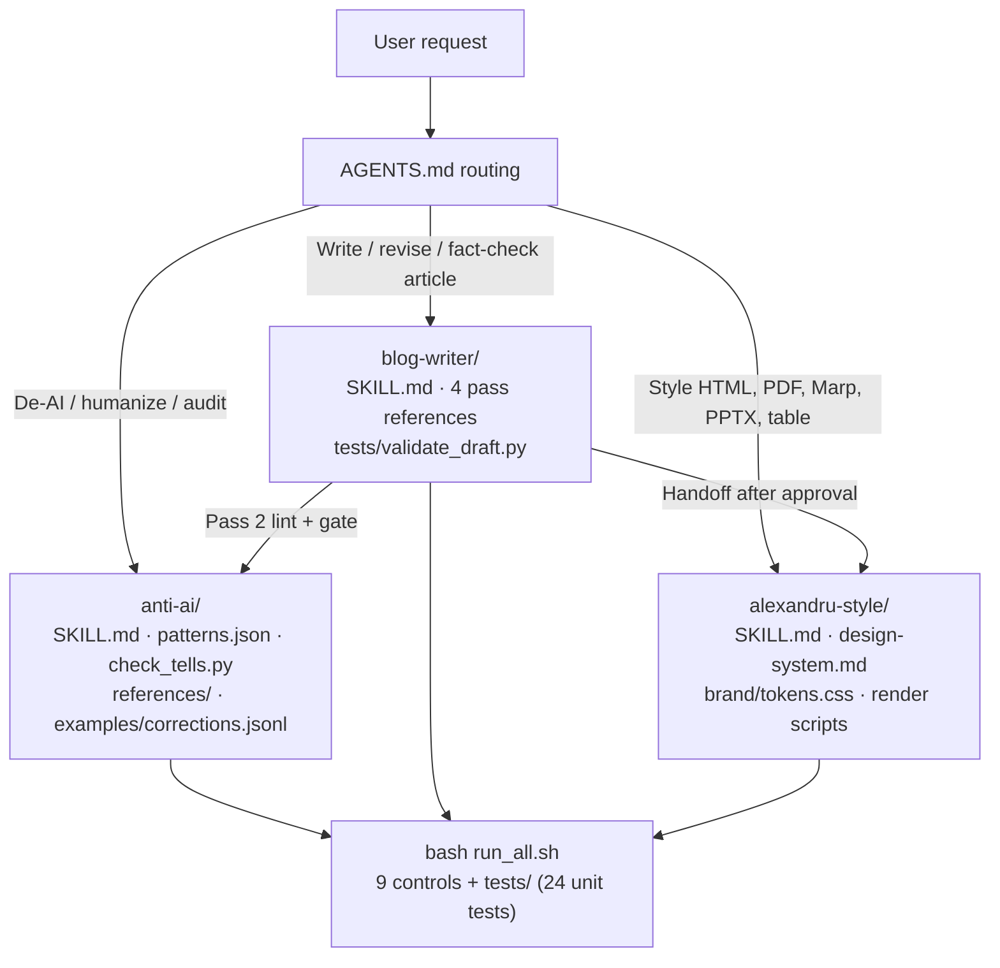
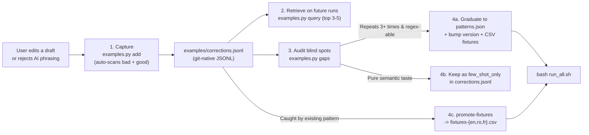

# alex-public-skills-collection

Portable, self-contained skills for AI-assisted writing, prose auditing, and personal brand styling. Each top-level folder holds one skill: a `SKILL.md` manifest, on-demand references, mechanical Python tools, and bidirectional tests.

Core linters, draft gates, the corrections database, and unit tests run offline with plain Python stdlib (no accounts, no telemetry). Optional PDF, screenshot, and PPTX rendering under `alexandru-style/brand/` uses Playwright, `python-pptx`, Poppler (`pdftoppm`), and LibreOffice (`soffice`).

## Skills at a glance

| Skill | Job | Mechanical gate |
|---|---|---|
| [anti-ai](./anti-ai/) | Multilingual (EN/RO/FR) prose linter (`patterns.json` + `check_tells.py`), measured house voice, human benchmarks, and a JSONL corrections database (`examples/`) | `python3 anti-ai/tests/run_tests.py` |
| [blog-writer](./blog-writer/) | Six-pass article pipeline: brief, sourced research, developmental edit, copy edit in voice, fact-check loop, human review gate | `python3 blog-writer/tests/validate_draft.py <draft.md>` |
| [alexandru-style](./alexandru-style/) | AG Style v1.0 design system from alexandrugris.ro (`design-system.md`) plus the merged production toolkit in `brand/` (`tokens.css`, templates, render scripts) | `python3 alexandru-style/tests/check_styled.py <file>` |

## Architecture

Each skill follows the Agent Skills open specification: one thin `SKILL.md` manifest stays in context for routing, `references/` loads on demand, Python scripts handle deterministic checks, and `tests/` enforces controls in both directions (cases that must pass and cases that must fail).



## Execution flow: writing an article end to end

The three skills compose in sequence. `blog-writer` owns research, structure, and verification; `anti-ai` guards prose quality and supplies past rewrites; `alexandru-style` handles visual rendering after content approval.

```mermaid
flowchart LR
    B["1. Brief<br/>idea, reader, format,<br/>1st-person vs external"] --> R["2. Research pass<br/>opened primary URLs<br/>+ [NEEDS SOURCE] gaps"]
    R --> P1["3. Pass 1: Dev editor<br/>Diataxis/Trenches archetype<br/>+ <structural_brief>"]
    P1 --> Q["4a. Few-shot retrieval<br/>examples.py query (top 3-5)"]
    Q --> P2["4b. Pass 2: Copy editor<br/>prose in voice"]
    P2 -->|"<escalation> on bad outline"| P1
    P2 --> L["4c. anti-ai lint<br/>check_tells.py + sign-off"]
    L -->|"Any HIGH hit blocks"| P2
    L -->|"0 HIGH"| FC["5. Fact-check loop<br/>max 2 rounds"]
    FC -->|"Dead link / contradiction"| R
    FC -->|"Span wording fix"| P2
    FC -->|"0 blocking"| RG["6. Human review gate<br/>draft + sources + gaps"]
    RG -->|"Feedback routed by cause"| P1
    RG -->|"User edits prose"| DB["Log rewrite<br/>examples.py add"]
    RG -->|"Approved + styled output"| ST["7. alexandru-style<br/>HTML / A4 PDF / deck<br/>+ check_styled.py"]
```



## How to write a blog article using these skills

1. **Start with a brief.** Give the agent a topic, reader, target length, language, and any personal notes or seed paragraphs, and mark which claims come from your own experience (no external source needed) versus claims that need primary links.
2. **Let Research run before drafting.** The agent searches primary sources (papers, official docs, interviews), opens every URL it plans to cite, notes counter-arguments, and marks open holes as `[NEEDS SOURCE]`.
3. **Review the `<structural_brief>` from Pass 1.** Pass 1 picks an archetype (Trenches story, Argument essay, Diataxis how-to, or Explanation) and maps evidence slots and per-section voice intent before writing prose.
4. **Draft and lint in Pass 2.** Before drafting, Pass 2 pulls 3 to 5 relevant past rewrites with `anti-ai/scripts/examples.py query`. After drafting, it runs `anti-ai/check_tells.py` and `blog-writer/tests/validate_draft.py`, fixes every HIGH hit, and checks headings, literal word sense, and endings by hand.
5. **Run the fact-check loop (max 2 rounds).** Every external claim and URL faces read-only verification. Unverifiable claims leave the draft or get recast; the pipeline never invents a replacement link.
6. **Approve at the Review Gate, then style.** Nothing ships before your sign-off. When you want a printable A4 PDF, HTML page, or Marp deck, `alexandru-style` renders it from `brand/templates/article.html` and verifies it with `alexandru-style/tests/check_styled.py`.

## Worked example: Gianpiero Petriglieri on leadership

Below is a real run of all three skills on a concrete prompt: *"Write a short blog section on Gianpiero Petriglieri's leadership ideas (holding and identity workspaces), lint it with anti-ai, validate the draft, and style it as a flowing A4 HTML page."*

### Step 1: Retrieve past leadership rewrites (`examples.py query`)

```sh
python3 anti-ai/scripts/examples.py query --lang en --topic "leadership holding petriglieri" --limit 3
```

Actual output injected into Pass 2 (~220 tokens):

```text
[ex-2026-11-19-012 | en | rules:1,2 | tags:abstraction,press-release,leadership,taste]
  BAD : Good leadership means balancing empathy with accountability across every level of the organization.
  GOOD: A manager has to hear what worries the team and still cut the project that loses money.
  WHY : Press-release abstraction ('balancing empathy with accountability') uses zero banned regex words yet says nothing concrete; name the exact conflicting actions.
[ex-2026-11-19-002 | en | rules:1,1b | tags:headline,metaphor,leadership]
  BAD : The restructuring that was right on paper still landed as a threat.
  GOOD: Silence at the all-hands was not agreement.
  WHY : Stock-pair headline mixing two clichés ('on paper' + 'landed as'); state the concrete scene event instead.
[ex-2026-11-19-001 | en | rules:1,1b | tags:metaphor,expansion,leadership]
  BAD : Care widens the room people have to think and act.
  GOOD: Care means people can decide, disagree and act without you in the room.
  WHY : Dead spatial metaphor ('widens the room'); deleting it leaves a gap, so expand into concrete actor behavior while keeping 'room' literal.
```

### Step 2: Research brief (opened primary sources)

```text
<research_brief>
claims:
  - claim: In a crisis, people already want to act and need "holding" (naming emotions, giving context and reality) before a lofty vision.
    stance: support
    url: https://hbsp.harvard.edu/product/H05KQR-PDF-ENG
    date: 2020-04-22
  - claim: Organizations act as "identity workspaces" (developed with Jennifer Petriglieri) that shape who people become; "nomadic professionals" gain mobility yet struggle to win trust.
    stance: support
    url: https://thinkers50.com/blog/new-leadership/
    date: 2016
gaps: []
</research_brief>
```

### Step 3: Outcome comparison (raw AI draft vs skills pipeline)

A typical unguided model draft on the same topic fails `anti-ai/check_tells.py` with **8 HIGH, 4 MEDIUM, and 4 LOW hits**:

```markdown
# Leadership in Crisis

In today's fast-paced world, it is important to note that leadership has undergone a pivotal shift. Gianpiero Petriglieri delves into the intricate tapestry of crisis management, arguing that holding carries the weight of organizational trust. Ultimately, leaders must leverage empathy to unlock human potential and foster a culture of resilience.
```

```text
$ python3 anti-ai/check_tells.py raw_ai_draft.md
by severity: {'high': 8, 'medium': 4, 'low': 4}
VERDICT: FAIL
```

Running the full `blog-writer` + `anti-ai` pipeline yields a sourced, human-register draft (first pass caught 2 MEDIUM hits on `"what happens next"` and `"on paper"`, which Pass 2 tightened before sign-off):

```markdown
FROM THE TRENCHES · LEADERSHIP · 2026-11-20

# During a crisis, people need clear ground before a vision.

When revenue drops and teams brace for cuts, a bright slide deck about next year misses the room. People already want to act; they lack a clear read on what the numbers mean for their job.

## Holding comes before vision.

Gianpiero Petriglieri, an organizational behavior professor at INSEAD who trained as a psychiatrist, calls that missing work "holding." In his April 2020 Harvard Business Review piece, [The Psychology Behind Effective Crisis Leadership](https://hbsp.harvard.edu/product/H05KQR-PDF-ENG), he argues that people in a crisis already want to act. A manager who holds names the pressure, states the facts on the table, and names the next step. That lets the team put its energy into real tasks rather than rumors.

## Workplaces shape who people become.

In a [Thinkers50 interview with Stuart Crainer](https://thinkers50.com/blog/new-leadership/), Petriglieri calls organizations "identity workspaces," a term he developed with Jennifer Petriglieri. Companies assign tasks, and they also shape how people see themselves at work. He also warns about "nomadic professionals": mobile managers who collect credentials across firms look qualified by resume alone, yet struggle to win trust from teams that stay put.

## What changes on Monday morning.

Before pitching a three-year roadmap to an anxious team, write down three facts: what changed, what stays intact, and who decides next. People remember how managers spoke when loss sat on the table.

## Sources

- [Gianpiero Petriglieri: The Psychology Behind Effective Crisis Leadership (Harvard Business Review, 2020)](https://hbsp.harvard.edu/product/H05KQR-PDF-ENG)
- [Thinkers50: The New Leadership, interview with Gianpiero Petriglieri](https://thinkers50.com/blog/new-leadership/)
```

Gate verification across all three skills on the final outcome:

```text
$ python3 anti-ai/check_tells.py petriglieri_holding.md
by severity: {'low': 1}
VERDICT: PASS

$ python3 blog-writer/tests/validate_draft.py petriglieri_holding.md
VERDICT: PASS

$ python3 alexandru-style/tests/check_styled.py petriglieri_holding.html
VERDICT: PASS
```

Rendering the styled HTML to a print-ready A4 PDF with proofing PNGs takes one command:

```sh
python3 alexandru-style/brand/scripts/render.py petriglieri_holding.html petriglieri_holding.pdf --png-dir previews/
```

## How to improve the `anti-ai` database and other rules

The skills improve through a closed loop instead of bloating `SKILL.md` with endless prose rules.



### Growing the `anti-ai` corrections database

1. **Log every real edit you make.** When you rewrite an AI sentence, record the `bad` text, your `good` rewrite, and `why`:

```sh
python3 anti-ai/scripts/examples.py add \
  --lang en \
  --bad "Good leadership means balancing empathy with accountability." \
  --good "A manager hears what worries the team and still cuts the project that loses money." \
  --why "Press-release abstraction with zero banned words; name the concrete conflicting actions." \
  --rules 1,2 \
  --tags abstraction,leadership,taste
```

`examples.py add` runs `check_tells.py` on both strings automatically. It records whether the scanner caught `bad` (`scanner_caught: true|false`) and rejects `good` if your rewrite triggers a HIGH tell.

2. **Mine scanner blind spots periodically:**

```sh
python3 anti-ai/scripts/examples.py gaps
```

Entries with `scanner_caught: false` group by tag. When the same pattern repeats across several drafts and has a reliable textual shape, add a versioned rule to `anti-ai/patterns.json` (plus a MUST-FAIL and MUST-PASS pair in `anti-ai/tests/fixtures-{en,ro,fr}.csv` and a concise note in `anti-ai/references/anti-ai-prompt.md`). Pure semantic taste (scene detail, press-release tone, poster morals) stays in `corrections.jsonl` with `status: "few_shot_only"` so `examples.py query` returns it on demand.

3. **Promote caught entries to permanent regression tests:**

```sh
python3 anti-ai/scripts/examples.py promote-fixtures --dry-run
```

### Updating `blog-writer` and `alexandru-style` rules

- **`blog-writer`:** When a failure repeats across drafts (for instance, a new banned heading shape or broken link pattern), add the prose instruction to the pass file that owns it (`research.md`, `developmental-editor.md`, `copy-editor.md`, or `fact-checker.md`), encode the mechanical part in `blog-writer/tests/validate_draft.py`, and add a unit test in `tests/test_checkers_unit.py`.
- **`alexandru-style`:** Edit `alexandru-style/brand/references/tokens.css` first (the single source of truth), mirror any color token change in `alexandru-style/design-system.md`, enforce new mechanical constraints in `alexandru-style/tests/check_styled.py`, and run `bash run_all.sh` (which verifies token sync, all three HTML templates, and the archive SHA-256).
- **Routing and end-to-end evals (`evals/`):** When you edit a `SKILL.md` `description` field, test routing against `evals/triggers.csv` (30 prompts including 10 negative controls). When you change workflow behavior, grade baseline vs skill-enabled outputs with `python3 evals/graders.py --case <id> --artifact <file>`.

## Repository layout & verification

```text
anti-ai/
  SKILL.md                     manifest: trigger description, audit & learning loop
  check_tells.py               multilingual scanner, heuristics, and fixture runner
  patterns.json                canonical versioned blocklist (EN/RO/FR)
  examples/corrections.jsonl   append-only human rewrites database
  scripts/examples.py          query, add, gaps, promote-fixtures, validate CLI
  references/                  portable prompts, house voice, benchmarks, RO/FR annexes
  tests/                       trilingual CSV fixtures, heuristics, and self-scan
blog-writer/
  SKILL.md                     six-pass pipeline manifest
  references/                  research, developmental-editor, copy-editor, fact-checker
  tests/                       validate_draft.py + positive/negative draft controls
alexandru-style/
  SKILL.md                     AG Style v1.0 manifest
  design-system.md             compact spec synced to brand/references/tokens.css
  brand/                       canonical tokens.css, style-spec, templates, render scripts, archive
  tests/                       check_styled.py + sample/anti-sample controls
tests/                         repo-wide spec, schema, token-sync, and checker unit tests
evals/                         Tier 3 trigger prompts and Tier 4 behavioral graders
run_all.sh                     one-command offline gate (runs in CI on every push/PR)
```

Prove any change with one command:

```sh
bash run_all.sh
```

The brand toolkit in [alexandru-style/brand/](./alexandru-style/brand/) migrated from `ag-personal-brand` on 2026-11-19. Its binary snapshot (17 OFL fonts, reference PDFs, sample deck, and screenshots) lives in [alexandru-style/brand/binaries-archive/](./alexandru-style/brand/binaries-archive/), and `run_all.sh` verifies its SHA-256 automatically.

## License

MIT, see [LICENSE](./LICENSE). It covers the whole collection. Bundled font licenses (SIL OFL 1.1) stay with their font family names.
