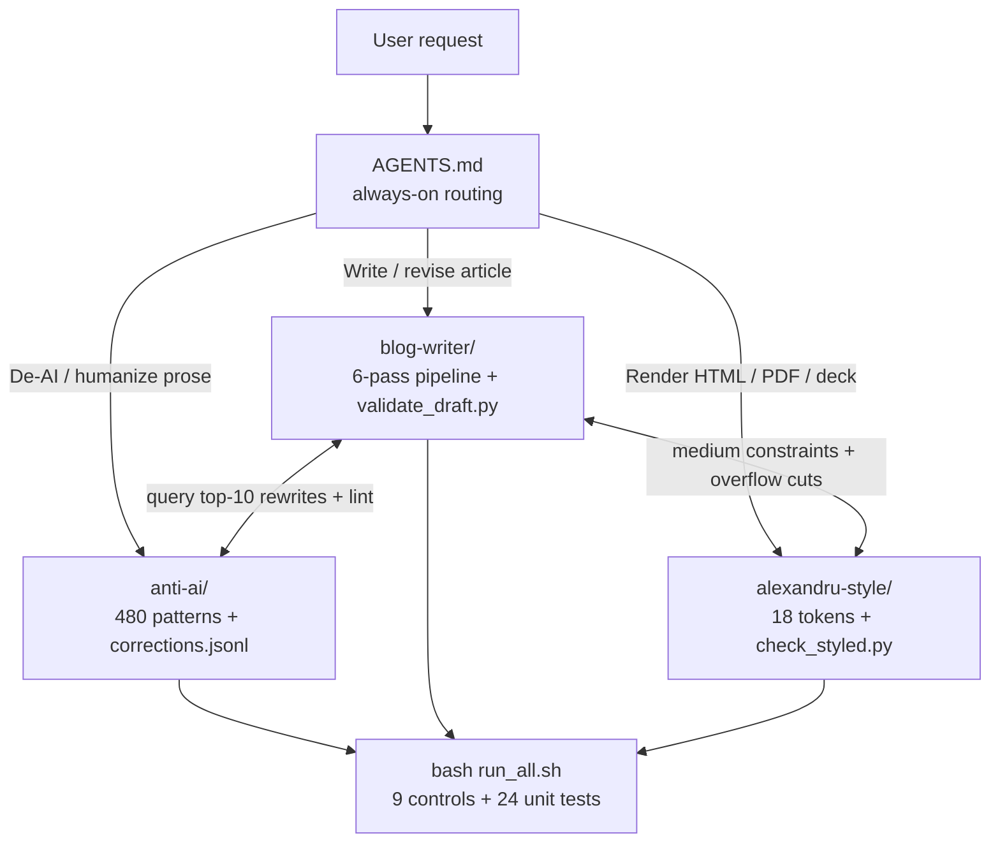

FROM THE TRENCHES · AGENT ARCHITECTURE · 2026-11-21

# Packaging taste as code

Twenty-five rejected sentences sit inside [anti-ai/examples/corrections.jsonl](https://github.com/alexandrugris/alex-public-skills-collection/blob/main/anti-ai/examples/corrections.jsonl), each paired with the rewrite I typed after arguing with my own agent. One of them replaced `"People are afraid after the all-hands announcement"` with `"By lunch, everyone on the floor has already done the math on their own salary."` Another replaced a two-line summary of a tense meeting with stiff faces in the front row, hands gripping paper coffee cups at the back, and the hum of a projector. Every time I rejected a draft line over more than a week of building and editing, the agent logged the pair, checked whether our 480-pattern scanner caught it, and encoded the underlying rule into a Markdown file or a Python test.

That feedback loop is the real reason this repository exists. Over the last month, I have read and listened almost exclusively to super-customized AI content: podcasts and technical briefings built solely around my current interests, for an audience of one. Reading and listening as the sole customer feels like the future of media, because generic feeds cannot compete with material built around the exact problem you are ruminating over that morning. Yet that future collapses the moment the output reads like standard model prose: padded transitions, vague metaphors, and confident citations to pages nobody opened. To make single-customer content worth reading, I had to package my own editorial taste, research discipline, and site design into three portable skills: `anti-ai`, `blog-writer`, and `alexandru-style`.

Building those skills meant choosing between rigid pipelines and autonomous loops, deterministic regexes and model-based judges, always-on instructions and on-demand context, all in a continuous conversation loop with my favourite AI agents. I did not design those choices up front on a whiteboard; they emerged out of back-and-forth conversations with the AI, often in YOLO mode, and looking back shows how closely that messy loop converged on published best practices because those practices are already baked into modern models and agent runners. To trace how that happened, this post follows five questions in order: how the three skills match Anthropic and OpenAI patterns, the tradeoffs behind every architectural choice, how live editing turned feedback into rules, when stronger models make these skills useless, and what survives the next model generation.

## How the three skills match Anthropic and OpenAI patterns

Each skill in `alex-public-skills-collection` follows the [Agent Skills specification](https://agentskills.io/specification), which Anthropic introduced and published as an open standard in late 2025. A skill is a folder holding a manifest, optional deep-dive references, executable scripts, and tests. At session startup, the agent loads only each skill's `name` and `description` (roughly 100 tokens per skill) into its system prompt. When a task matches the description, the agent reads the full manifest and pulls individual reference files only as needed.

Anthropic calls this three-stage loading pattern [progressive disclosure](https://www.anthropic.com/research/equipping-agents-for-the-real-world-with-agent-skills), and its purpose is context hygiene. As [Steve Kinney argues](https://stevekinney.com/writing/agent-skills), skills act as a context-management strategy rather than a source of new model intelligence: they decide what enters the context window and when. In our repository, a thin top-level instructions file holds only always-on routing rules (which skill owns which task, and never editing the detector to fix a failing draft), while the heavy checklists live one level down inside each skill's reference folder.

Inside `blog-writer`, the architecture follows what Anthropic's [Building effective agents](https://www.anthropic.com/research/building-effective-agents) guide calls a "prompt chaining" workflow with programmatic "gate" checks, paired with an "evaluator-optimizer" loop. Rather than letting an autonomous loop improvise an article from scratch, the pipeline runs six steps in order:

1. **Brief:** lock topic, reader, depth tier (`deep` by default), target medium, and the boundary between first-person experience and external claims.
2. **Research:** run three to four bounded search rounds, opening 10 to 15+ distinct URLs and 2 to 3 counter-arguments before outlining. As documented in [the research pass guide](https://github.com/alexandrugris/alex-public-skills-collection/blob/main/blog-writer/references/research.md), the pass logs every claim in `<research_brief>` and tags unresolved points as open source gaps.
3. **Pass 1 (Developmental editor):** choose one narrative archetype (Trenches story, Argument essay, How-to, or Explanation), build an [explicit concept inventory](https://github.com/alexandrugris/alex-public-skills-collection/blob/main/blog-writer/references/developmental-editor.md) from opened sources, and output `<structural_brief>`.
4. **Pass 2 (Copy editor):** retrieve up to 10 past rewrites for few-shot calibration, write prose in voice, and run the tell scanner plus the draft validator. When the scanner finds any `HIGH` pattern, it prints the offending line, severity, and suggested fix, and exits non-zero with `VERDICT: FAIL`. The copy-editor instructions stop the pipeline before fact-checking while any `HIGH` hit remains. The agent reads the flagged lines, rewrites those sentences in place, and re-runs the scanner until `HIGH` hits drop to zero. If fixing the wording shows that the outline itself forced a cliché or dead-end section, Pass 2 emits an `<escalation>` tag that routes the work back to Pass 1 for a new structural redo instead of patching broken prose.
5. **Fact-check loop (max 2 rounds):** verify every external claim, author term, and URL against opened pages in read-only mode, deleting or recasting unverifiable claims instead of inventing replacement links.
6. **Human review gate:** present the draft, opened sources, fixed findings, and open gaps, then wait for approval.

For verification, we split checks into two layers that mirror [Anthropic's evals guide](https://www.anthropic.com/research/demystifying-evals-for-ai-agents) (which separates "code-based", "model-based", and "human" graders, as well as "capability" vs. "regression" evals) and [OpenAI's guide to testing agent skills](https://developers.openai.com/blog/eval-skills). The first layer runs offline before any commit: nine bidirectional controls where clean drafts and valid style pages pass while tell-laced seeds, planted fabrications, and broken style samples fail, alongside 24 unit tests. The second layer tests the live model. It checks whether the agent triggers the right skill across 30 prompts (including 10 negative controls that stay silent), and runs A/B comparisons between unguided and skill-guided outputs against OpenAI's four goal types ("outcome goals", "process goals", "style goals", and "efficiency goals").

The exact verification scripts and files live here:

- **Offline regression gate:** `bash run_all.sh` runs all nine bidirectional controls and the 24 unit tests in `tests/`.
- **Prose and draft gates:** `anti-ai/check_tells.py`, `anti-ai/tests/run_tests.py`, and `blog-writer/tests/validate_draft.py`.
- **Style gate:** `alexandru-style/tests/check_styled.py` and `alexandru-style/brand/scripts/check.py`.
- **Live routing and A/B evals:** `evals/triggers.csv`, `evals/cases.json`, and `evals/graders.py`.

## Tradeoffs behind every architectural choice

Every layer in this system trades token budget, latency, or maintenance effort for predictability. Putting those choices side by side clarifies where the wrapper code pays off and where it drags.

| Architectural choice | What it buys | What it costs | Best practice alignment |
|---|---|---|---|
| Thin `SKILL.md` + on-demand `references/` | Keeps startup context near ~100 tokens per skill; avoids drowning the model in unused rules | Adds tool-call hops; risks routing ambiguity if `description` triggers overlap | [Agent Skills spec](https://agentskills.io/specification); [Anthropic skill-authoring docs](https://platform.claude.com/docs/en/agents-and-tools/agent-skills/best-practices) |
| Deterministic regex + AST gates (`check_tells.py`, `validate_draft.py`) | Zero drift across models and runs; fast, cheap, reproducible CI checks | Brittle on nuance; overreaches by design (253 MEDIUM patterns require human `REVIEW` judgment) | [OpenAI evals](https://developers.openai.com/blog/eval-skills); [Anthropic code-based graders](https://www.anthropic.com/research/demystifying-evals-for-ai-agents) |
| JSONL corrections DB (`examples.py query --limit 10`) | Learns from real edits in ~700 tokens; clean git diffs; `gaps` surfaces scanner blind spots | Requires manual logging discipline; keyword retrieval can miss structural parallels | [OpenAI Specify-Measure-Improve](https://openai.com/index/evals-drive-next-chapter-of-ai/) |
| Rigid 6-pass pipeline (`blog-writer`) | Prevents skipped research, cold-start listicles, and fabricated citations | Higher latency and token cost; overkill for a quick 300-word note | [Anthropic workflows vs. agents](https://www.anthropic.com/research/building-effective-agents) |
| Bidirectional test controls (`run_all.sh`) | Catches silent detector rot when a MUST-FAIL fixture stops firing | Doubles fixture maintenance; every new pattern requires both MUST-FAIL and MUST-PASS rows | [OpenAI negative controls](https://developers.openai.com/blog/eval-skills) |

The hardest tradeoff sits between deterministic code graders and model-based rubrics. Our regex blocklist holds 480 phrases (58 HIGH, 253 MEDIUM, and 169 LOW across English, Romanian, and French) and catches dead metaphors and filler openers instantly across Google's Antigravity, Mistral Large, and ChatGPT. Yet 16 of the 25 entries in the corrections database slipped past the scanner (`scanner_caught: false`). A regex flags `"delves into the intricate tapestry"`, while it stays blind to a paragraph opening with an unintroduced contrast or a flat summary of a tense room. That gap is why the linter uses three verdicts (`FAIL` on HIGH, `REVIEW` on MEDIUM, `PASS` otherwise) and pairs deterministic gates with few-shot examples plus a manual Clean-Scan Sign-off.

A second tradeoff sits in skill routing. [Anthropic's skill-authoring docs](https://platform.claude.com/docs/en/agents-and-tools/agent-skills/best-practices) warn that `description` fields compete in the same system prompt once a library grows. Early on, a literal YAML block scalar in our frontmatter left a trailing newline on `name:`, causing the CLI to emit 104 warnings and silently skip two skills. Switching to plain scalars fixed discovery, and our trigger suite now tests positive and negative routing explicitly. Even so, as [Steve Kinney observes](https://stevekinney.com/writing/agent-skills), multi-skill composition remains probabilistic: two runs of the same prompt can still trigger different skill combinations depending on phrasing or context state.

## How live editing turned feedback into rules

The system did not start as a diagram; it grew out of arguments over concrete drafts across more than a week of sustained work. Early in the build, the agent produced documentation prose instead of a story, and later clobbered a root file on a wrong-path push. Each failure forced a structural fix: we locked ownership rules into the top-level agent instructions, wired the nine-control gate script, and added the hard guardrail to fix the prose whenever a rule fires instead of weakening the detector.

The deeper changes happened over the following days of live prose editing, when I reviewed drafts line by line and pushed back on subtle machine habits that passed every regex check. Each round of comments turned directly into updated skill rules:

- **Scene pacing and description levels:** when the agent summarized a tense all-hands in two clipped sentences and mixed physical posture with imputed motives (`"Resentment and insecurity sit in the warm air"`), I rewrote the scene to stay strictly on observable behavior: stiff faces, dropped shoulders, and hands gripping coffee cups. That feedback graduated into both the developmental and copy-editor guides.
- **Causal bridges, roadmaps, and concept inventories:** when a draft jumped from an opening scene straight into an abstract summary, or dropped an unannounced foil concept in the second-to-last paragraph, we required a concrete essay roadmap whose idea names match the later section headings directly, and forced Pass 1 to declare an explicit concept inventory limited to exact author terms from opened primary sources.
- **No manufactured conflict or unattributed aphorisms:** when an outline framed two complementary research lenses as conflicting needs, I corrected it to two different angles and banned invented conflicts between abstract ideas unless real people disagree. Later, when a draft compressed a critique into an unattributed parallel contrast pair, we updated the editorial and fact-check guides to forbid unattributed aphorisms and enforce named attribution with concrete explanation.
- **Filenames in tables, flowing prose in paragraphs:** when dense script paths and file lists broke the flow of narrative paragraphs, we moved file references into bullet lists and tables, strengthened the rule against dismissive `"rather than"` tails, and explicitly preserved room for long, flowing, explanatory sentences when the argument calls for them.
- **Feedback routing by root cause:** instead of patching bad structure with word-level edits, the pipeline routes structural complaints ("this intro drags") back to Pass 1, wording complaints to Pass 2, and factual errors to Research, then re-runs Fact-check.

To keep the main skill manifests lean while retaining those lessons, the examples script queries the corrections database before every draft, pulling up to 10 topic-matched rewrites and general-taste constructs. Periodically mining uncaught entries groups every `scanner_caught: false` edit by tag so recurring patterns graduate into regex rules and fixtures, while pure semantic taste stays as few-shot examples.

## When stronger models make these skills useless

Every hand-crafted wrapper eventually meets Rich Sutton's [Bitter Lesson](http://www.incompleteideas.net/IncIdeas/BitterLesson.html): across seventy years of AI research, "general methods that leverage computation are ultimately the most effective," specifically search and learning, while systems packed with human domain heuristics plateau. In [Anthropic's evals post](https://www.anthropic.com/research/demystifying-evals-for-ai-agents), the authors note that frontier models already discover creative policy loopholes that outgrow static evaluation suites. Similarly, [agent-hypervisor's review of agentic coding](https://agent-hypervisor.ai/posts/bitter-lesson-of-agentic-coding/) documents how rigid multi-step wrappers often turn into dead weight once base models learn to plan reliably over long horizons.

By that logic, large parts of this repository have a finite shelf life. Three layers will become obsolete first:

- **Word-level blocklists:** as post-training and RLHF move away from overused transition clichés, or as models match a user's style from a handful of samples in-context, maintaining 480 regexes to ban `"delve"` and `"tapestry"` will feel like maintaining a spellchecker for a typo the keyboard no longer makes.
- **Prescriptive step-by-step chaining:** once a single model reliably plans structure, retrieves primary sources, checks its own flow, and avoids unannounced concepts in one pass, splitting Brief, Pass 1, and Pass 2 into separate scripted stages only adds latency.
- **Formatting and token hand-holding:** stronger multimodal models can inspect a rendered PDF screenshot directly and adjust spacing without needing a 120-line checklist of layout rules.

Yet [as Drew Breunig argues](https://www.dbreunig.com/2025/08/01/does-the-bitter-lesson-have-limits.html), the Bitter Lesson depends on having crisp, quantifiable objectives (like chess and Go) and cheap compute. Where organizational processes or editorial quality resist clean mathematical reduction, pure scaling hits practical limits: Stockfish beating Leela with a tiny, focused model inside a specialized search pipeline shows that domain structure still wins when compute or data hits a ceiling.

## What survives the next model generation

Because personal writing and real-world fact checking lack the crisp win conditions of chess or Go, three pieces of this architecture will stay useful even when models are far stronger. Putting energy into those three layers now avoids building throwaway prompts:

1. **Idiosyncratic personal taste:** a general model optimizes for an average reader, whereas my preference for 15-word sentences, zero em-dashes, flowing explanatory paragraphs, and concrete room details is arbitrary and personal. Even a superintelligent model needs a compact representation of *my* taste, whether in a corrections log or a fine-tuned adapter, before creating single-customer content.
2. **External ground-truth verification:** scaling parameters does not tell a model whether a URL returns HTTP 404 today or whether a quote appears in a YouTube transcript, although modern agent runners are already very good at catching these once they inspect the source. Deterministic tool checks verify the external environment rather than compensating for weak reasoning.
3. **Private context and provenance:** a model cannot guess unpublished reading notes or local brand tokens without reading them from disk. Progressive disclosure remains useful simply because private context is infinite and attention is still finite.

OpenAI's [evals playbook](https://openai.com/index/evals-drive-next-chapter-of-ai/) summarizes the core habit behind all of this: "Specify -> Measure -> Improve." For builders designing agentic systems today, the practical rule is to invest in the pieces that survive model upgrades (verification scripts, negative-control evals, and a clean log of your own taste) while keeping the multi-step prompt workflow modular enough to delete the day a stronger model no longer needs it.

## Sources

- [Agent Skills specification](https://agentskills.io/specification)
- [Anthropic Engineering: Equipping agents for the real world with Agent Skills](https://www.anthropic.com/research/equipping-agents-for-the-real-world-with-agent-skills)
- [Anthropic Research: Building effective agents](https://www.anthropic.com/research/building-effective-agents)
- [Anthropic Engineering: Demystifying evals for AI agents](https://www.anthropic.com/research/demystifying-evals-for-ai-agents)
- [Anthropic Platform Docs: Skill authoring best practices](https://platform.claude.com/docs/en/agents-and-tools/agent-skills/best-practices)
- [OpenAI Developers: Testing agent skills systematically with evals](https://developers.openai.com/blog/eval-skills)
- [OpenAI: How evals drive the next chapter in AI for businesses](https://openai.com/index/evals-drive-next-chapter-of-ai/)
- [Rich Sutton: The Bitter Lesson](http://www.incompleteideas.net/IncIdeas/BitterLesson.html)
- [Drew Breunig: Does the Bitter Lesson Have Limits?](https://www.dbreunig.com/2025/08/01/does-the-bitter-lesson-have-limits.html)
- [Steve Kinney: Agent Skills, Stripped of Hype](https://stevekinney.com/writing/agent-skills)
- [Agent Hypervisor: The Bitter Lesson of Agentic Coding](https://agent-hypervisor.ai/posts/bitter-lesson-of-agentic-coding/)
- [alex-public-skills-collection: Corrections database (`corrections.jsonl`)](https://github.com/alexandrugris/alex-public-skills-collection/blob/main/anti-ai/examples/corrections.jsonl)
- [alex-public-skills-collection: Research pass (`research.md`)](https://github.com/alexandrugris/alex-public-skills-collection/blob/main/blog-writer/references/research.md)
- [alex-public-skills-collection: Developmental editor (`developmental-editor.md`)](https://github.com/alexandrugris/alex-public-skills-collection/blob/main/blog-writer/references/developmental-editor.md)
