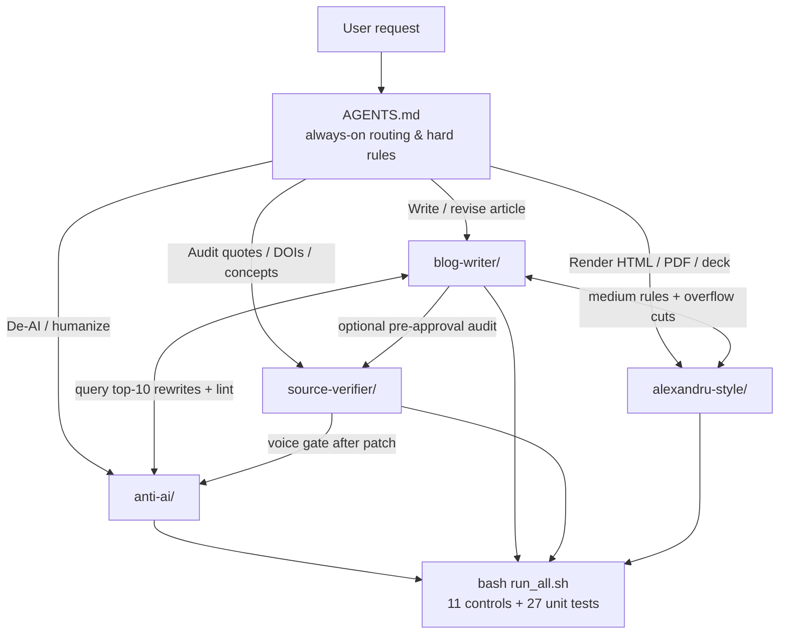

FROM THE TRENCHES · AGENT ARCHITECTURE · 2026-11-21

# Packaging taste as code

Twenty-five rejected sentences sit inside [the corrections database](https://github.com/alexandrugris/alex-public-skills-collection/blob/main/anti-ai/examples/corrections.jsonl), each paired with the rewrite I typed after arguing with my own agent. One entry replaced an abstract mood label about resentment sitting in the warm air with observable room behavior: faces stiffening in the front rows, shoulders dropping at the back, and hands gripping paper coffee cups. A second entry replaced vague press-release phrasing about balancing empathy with accountability across every level of an organization with a concrete manager action: hearing what worries the team and still cutting the project that loses money. Every time I rejected a draft line over more than a week of building and editing, the agent logged the pair, checked whether our regex scanner caught it, and encoded the underlying rule into a Markdown guide or a Python test.

Over the last month, I have read and listened almost exclusively to super-customized AI content: podcasts and technical briefings built solely around my current interests, for an audience of one. Reading and listening as the sole customer feels like the future of media, because generic feeds cannot compete with material built around the exact problem you are ruminating over that morning. Yet when the output reads like AI, it becomes quickly boring, stale, and attention dissipates. To make single-customer content worth reading, I had to package my own editorial taste, research discipline, source verification, and site design into four portable skills: `anti-ai`, `blog-writer`, `source-verifier`, and `alexandru-style`.

Building those skills meant choosing between rigid pipelines and autonomous loops, deterministic regexes and model-based judges, always-on instructions and on-demand context, all in a continuous conversation loop with my favourite AI agents. Those choices emerged out of back-and-forth conversations with the AI, often in YOLO mode, and looking back shows how closely that messy loop converged on published best practices because those practices are already baked into modern models and agent runners. To trace how the system works and where it breaks, this post follows five topics in order:

- How the four skills match Anthropic and OpenAI patterns
- How the skills and concepts work together
- Tradeoffs behind every architectural choice
- When stronger models make these skills useless
- What survives the next model generation

## How the four skills match Anthropic and OpenAI patterns

Each skill in `alex-public-skills-collection` follows the [Agent Skills specification](https://agentskills.io/specification), which Anthropic introduced and published as an open standard in late 2025. Under that specification, a skill is a directory holding a `SKILL.md` manifest plus optional subdirectories for scripts, references, and assets. At session startup, the agent loads only each skill's `name` and `description` (roughly 100 tokens per skill) into its system prompt. When a user request matches a skill's description, the agent reads the full `SKILL.md` and pulls individual reference files only as the task requires them.

Anthropic calls this three-stage loading pattern "progressive disclosure" in [Equipping agents for the real world with Agent Skills](https://www.anthropic.com/research/equipping-agents-for-the-real-world-with-agent-skills), noting that "agents with a filesystem and code execution tools don't need to read the entirety of a skill into their context window when working on a particular task." As [Steve Kinney argues](https://stevekinney.com/writing/agent-skills), "Agent skills are not a new capability—they're a context management strategy." They govern what enters the model's working memory and when, keeping the top-level routing file thin while storing deep checklists one level down.

Inside `blog-writer`, the article pipeline follows what Anthropic's [Building effective agents](https://www.anthropic.com/research/building-effective-agents) guide defines as a "prompt chaining" workflow: "Prompt chaining decomposes a task into a sequence of steps, where each LLM call processes the output of the previous one. You can add programmatic checks (see 'gate' in the diagram below) on any intermediate steps to ensure that the process is still on track." A gate check is a deterministic script that runs between model steps. It halts the pipeline when output violates a structural or factual rule, forcing the agent to fix the defect before advancing.

For verification, our repository separates offline deterministic checks from live model evaluations, matching [Anthropic's evals guide](https://www.anthropic.com/research/demystifying-evals-for-ai-agents) (which groups graders into "code-based, model-based, and human" tiers) and [OpenAI's guide to testing agent skills](https://developers.openai.com/blog/eval-skills). In our offline suite, bidirectional controls back every major rule: paired test inputs where known-good drafts and style pages must exit `0`, while known-bad drafts (such as a tell-laced paragraph, a planted fabrication, or a style anti-sample) must exit non-zero. Testing in both directions catches silent detector rot, where a script stops firing on defects and passes everything by default.

On the live-evaluation side, OpenAI proposes four goal categories for scoring an agent skill: "Outcome goals" (did the task complete?), "Process goals" (did the agent invoke the skill and follow the intended steps?), "Style goals" (does the output follow your conventions?), and "Efficiency goals" (did it finish without thrashing or excessive token use?). Our current evaluation suite encodes the first three categories: deterministic artifact checks grade outcome goals, source-link and structure checks grade process goals, and the prose linter plus rubric checks grade style goals. We omit efficiency goals (such as counting command executions or capping token budgets per run) in this version and leave them as a manual check during interactive sessions.

The AI generated every verification script, regression fixture CSV, and evaluation dataset in this repository through iterative feedback with me. Whenever a draft slipped past the scanner or a rule behaved unexpectedly, I described the failure, the agent wrote or updated the Python checker and its test fixtures, and the offline gate locked that fix in place for future runs.

## How the skills and concepts work together

A root routing file (`AGENTS.md`) directs each request to the skill that owns it, and a global gate script (`run_all.sh`) verifies all four skills before any change ships. When a task spans research, drafting, citation auditing, and styling, all four skills operate inside one shared session context:

Each skill encodes one distinct editorial or engineering role so their concerns stay separate:

- **`blog-writer` (editorial pipeline and blog construction concepts):** Runs six passes in sequence: Brief, multi-round [deep research](https://github.com/alexandrugris/alex-public-skills-collection/blob/main/blog-writer/references/research.md) (opening 10–15+ primary sources and 2–3 counter-arguments), [developmental editing](https://github.com/alexandrugris/alex-public-skills-collection/blob/main/blog-writer/references/developmental-editor.md) (Pass 1), copy editing (Pass 2), fact-checking, and human approval. Pass 1 enforces core blog-construction concepts. It picks a careful narrative archetype (such as a Trenches story or Explanation) instead of a listicle, announces the roadmap in the intro, matches section headings directly to those ideas, and declares an explicit concept inventory so the draft explains every introduced term. Pass 2 pairs automated tell scanning with a manual **Clean-Scan Sign-off**: reading the draft by hand to verify short direct titles, literal word sense, and concrete endings, because regexes only catch registered patterns. Whenever a `HIGH` hit fires, the scanner stops the pipeline before fact-checking. The agent rewrites the flagged lines or emits an `<escalation>` back to Pass 1 if the outline itself forced the cliché. User feedback routes by root cause: structure goes back to Pass 1, wording to Pass 2, and facts to Research.
- **`anti-ai` (deterministic linter and taste memory):** Combines 482 versioned regex patterns (across English, Romanian, and French) with rhythm heuristics (sentence length bands, passive voice, parallel pairs) and returns `FAIL` on high hits, `REVIEW` on medium-only hits, or `PASS`. To capture taste that regexes miss without bloating `SKILL.md`, a local JSONL database stores bad-to-good rewrite pairs; before each draft, the agent pulls up to 10 relevant rewrites for few-shot calibration, and periodically mines uncaught misses to graduate recurring patterns into rules.
- **`source-verifier` (adversarial citation and concept audit):** Runs an isolated read-only audit on finished drafts before publication. It freezes a structural snapshot (title, headings, opening hash, and word count) and enforces anti-collapse guardrails (capping body edits at a 15% token diff and 10% word shrinkage), so verifying quotes character-for-character and checking concept fidelity never flattens the essay's argument or voice.
- **`alexandru-style` (presentation and layout system):** Separates visual design from prose writing. It supplies per-medium layout rules (flowing A4 print, web pages, and slide decks), enforces orthogonal 90-degree diagram connectors, and validates rendered HTML against a passing sample and a failing anti-sample.

## Tradeoffs behind every architectural choice

Every layer in this system trades token budget, latency, or maintenance effort for predictability. Putting those choices side by side clarifies what each mechanism buys and what it costs:

| Architectural choice | What it buys | What it costs | Best practice alignment |
|---|---|---|---|
| Thin `SKILL.md` + on-demand references | Keeps startup context near ~100 tokens per skill; prevents unused rules from crowding working memory | Adds tool-call hops; risks routing ambiguity when `description` triggers overlap | [Agent Skills spec](https://agentskills.io/specification); [Anthropic skill-authoring docs](https://platform.claude.com/docs/en/agents-and-tools/agent-skills/best-practices) |
| Deterministic regex + AST gates | Zero drift across models and runs; fast, cheap, reproducible CI checks | Brittle on nuance; 253 medium patterns require human `REVIEW` judgment | [OpenAI evals](https://developers.openai.com/blog/eval-skills); [Anthropic code-based graders](https://www.anthropic.com/research/demystifying-evals-for-ai-agents) |
| JSONL corrections DB (top-10 few-shot recall) | Learns from real edits in ~700 tokens; clean git diffs; surfaces scanner blind spots | Requires manual logging discipline; keyword retrieval can miss structural parallels | [OpenAI Specify-Measure-Improve](https://openai.com/index/evals-drive-next-chapter-of-ai/) |
| Rigid 6-pass pipeline + isolated `source-verifier` | Prevents skipped research, fabricated citations, and verification collapse | Higher latency and token cost; heavy for a quick 300-word note | [Anthropic workflows vs. agents](https://www.anthropic.com/research/building-effective-agents) |
| Bidirectional test controls (`run_all.sh`) | Catches silent detector rot when a MUST-FAIL fixture stops firing | Doubles fixture maintenance; every new pattern needs both pass and fail rows | [OpenAI negative controls](https://developers.openai.com/blog/eval-skills) |

The main verification gap sits between deterministic code graders and model-based rubrics. Our regex blocklist catches dead metaphors and filler openers identically across Google's Antigravity, Mistral Large, and ChatGPT. Yet 17 of the 25 entries in the corrections log slipped past the scanner, because regexes cannot tell when a paragraph jumps to a new topic without a bridge or when an abstract phrase hides a missing concrete actor. That is why `anti-ai` splits verdicts into `FAIL`, `REVIEW`, and `PASS`, pairing deterministic gates with few-shot examples and the manual Clean-Scan Sign-off.

A second tradeoff sits in skill routing. [Anthropic's skill-authoring docs](https://platform.claude.com/docs/en/agents-and-tools/agent-skills/best-practices) explain that a skill's `description` field is how the model selects the right skill from potentially 100+ candidates. As [Steve Kinney observes](https://stevekinney.com/writing/agent-skills), "composition is not deterministic. Two runs of the same prompt can trigger different skill combinations depending on subtle phrasing differences, context window state, or even how many other skills are loaded." Our routing evaluation suite tests positive and negative triggers across 30 prompts to measure that drift explicitly.

## When stronger models make these skills useless

Every hand-crafted wrapper eventually meets Rich Sutton's [Bitter Lesson](http://www.incompleteideas.net/IncIdeas/BitterLesson.html): across seventy years of AI research, "general methods that leverage computation are ultimately the most effective, and by a large margin," specifically search and learning, while systems packed with human domain heuristics plateau. In [Anthropic's evals post](https://www.anthropic.com/research/demystifying-evals-for-ai-agents), the authors note that frontier models already discover creative policy loopholes that outgrow static evaluation suites. Similarly, [agent-hypervisor's review of agentic coding](https://agent-hypervisor.ai/posts/bitter-lesson-of-agentic-coding/) documents how rigid multi-step wrappers often turn into dead weight once base models learn to plan reliably over long horizons.

By that logic, three layers of this repository have a finite shelf life:

- **Word-level blocklists:** as post-training moves models away from overused transition clichés, or as models match a user's style from a handful of samples in-context, keeping 482 regexes to ban individual stock phrases becomes redundant.
- **Prescriptive step-by-step chaining:** once a single model reliably plans structure, retrieves primary sources, checks its own flow, and avoids unannounced concepts in one pass, splitting Brief, Pass 1, and Pass 2 into separate scripted stages only adds latency.
- **Formatting and token hand-holding:** stronger multimodal models can inspect a rendered PDF screenshot directly and adjust spacing without needing a checklist of layout rules.

Yet [as Drew Breunig argues](https://www.dbreunig.com/2025/08/01/does-the-bitter-lesson-have-limits.html), the Bitter Lesson depends on having crisp, quantifiable objectives (like chess and Go) and cheap compute. Where organizational processes or editorial quality resist clean mathematical reduction, pure scaling hits practical limits: Stockfish beating Leela with a tiny, focused model inside a specialized search pipeline shows that domain structure still wins when compute or data hits a ceiling.

## What survives the next model generation

Because personal writing and real-world fact checking lack the crisp win conditions of chess or Go, three pieces of this architecture will stay useful even when models are far stronger:

1. **Idiosyncratic personal taste:** a general model optimizes for an average reader, whereas my preference for 15-word sentences, zero em-dashes, flowing explanatory paragraphs, and concrete room details is arbitrary and personal. Even a superintelligent model needs a compact representation of *my* taste, whether in a corrections log or a fine-tuned adapter, before creating single-customer content.
2. **External ground-truth verification:** scaling parameters does not tell a model whether a URL returns HTTP 404 today or whether a quote appears in a YouTube transcript, although modern agent runners are already very good at catching these once they inspect the source. Deterministic tool checks verify the external environment rather than compensating for weak reasoning.
3. **Private context and provenance:** a model cannot guess unpublished reading notes or local brand tokens without reading them from disk. Progressive disclosure remains useful simply because private context is infinite and attention is still finite.

OpenAI's [evals playbook](https://openai.com/index/evals-drive-next-chapter-of-ai/) summarizes the core habit behind all of this: "Don't hope for 'great.' Specify it, measure it, and improve toward it." For builders designing agentic systems today, the practical rule is to invest in the pieces that survive model upgrades (verification scripts, negative-control evals, and a clean log of your own taste) while keeping the multi-step prompt workflow modular enough to delete the day a stronger model no longer needs it.

## Sources

- [Agent Skills specification](https://agentskills.io/specification)
- [Anthropic Engineering: Equipping agents for the real world with Agent Skills](https://www.anthropic.com/research/equipping-agents-for-the-real-world-with-agent-skills)
- [Anthropic Research: Building effective agents](https://www.anthropic.com/research/building-effective-agents)
- [Anthropic Engineering: Demystifying evals for AI agents](https://www.anthropic.com/research/demystifying-evals-for-ai-agents)
- [Anthropic Platform Docs: Skill authoring best practices](https://platform.claude.com/docs/en/agents-and-tools/agent-skills/best-practices)
- [OpenAI Developers: Testing agent skills systematically with evals](https://developers.openai.com/blog/eval-skills)
- [OpenAI: How evals drive the next chapter in AI for businesses](https://openai.com/index/evals-drive-next-chapter-of-ai/)
- [Rich Sutton: The Bitter Lesson](http://www.incompleteideas.net/IncIdeas/BitterLesson.html)
- [Drew Breunig: Does the Bitter Lesson Have Limits?](https://www.dbreunig.com/2025/08/01/does-the-bitter-lesson-have-limits.html)
- [Steve Kinney: Agent Skills, Stripped of Hype](https://stevekinney.com/writing/agent-skills)
- [Agent Hypervisor: The Bitter Lesson of Agentic Coding](https://agent-hypervisor.ai/posts/bitter-lesson-of-agentic-coding/)
- [alex-public-skills-collection: Corrections database (corrections.jsonl)](https://github.com/alexandrugris/alex-public-skills-collection/blob/main/anti-ai/examples/corrections.jsonl)
- [alex-public-skills-collection: Research pass (research.md)](https://github.com/alexandrugris/alex-public-skills-collection/blob/main/blog-writer/references/research.md)
- [alex-public-skills-collection: Developmental editor (developmental-editor.md)](https://github.com/alexandrugris/alex-public-skills-collection/blob/main/blog-writer/references/developmental-editor.md)
