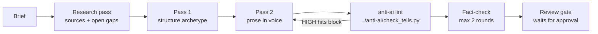
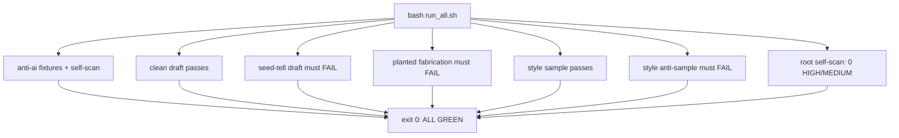

FROM THE TRENCHES · AGENT SKILLS · 2026-11-19

# A skill is a tested package, not a prompt.

This repository ships three agent skills I use every week: `anti-ai`, `blog-writer`, and `alexandru-style`. I designed and built all three with Mistral Large, running as the agent in Vibe, and I versioned them like small software products, because that is what they are. The git history says the rest: 46 commits between 11:13 and 17:37 on 2026-11-19, from a first linter with 442 patterns to a collection with 473 patterns, three skills, and one gate script that runs all of it. This essay is the story of that day and the architecture it produced. It covers what a skill is per the open standard, how each skill was built and calibrated, what broke along the way, and which parts turned out to matter.

## The log line that taught me skills are parsed, not read.

Earlier today I opened `~/.vibe/logs/vibe.log` for an unrelated reason and found 104 identical warnings:

```
Failed to parse skill at /Users/alexgris/.vibe/skills/blog-writer/SKILL.md:
1 validation error for SkillMetadata
name: String should match pattern '^[a-z0-9]+(-[a-z0-9]+)*$' [input_value='blog-writer\n']
```

All three skills are symlinked into `~/.vibe/skills/`, yet only `anti-ai` showed up in my session's skill list. The difference was two lines of YAML. `blog-writer` and `alexandru-style` had this:

```yaml
name: |
  blog-writer
```

A literal block scalar keeps its trailing newline, so the validator saw `blog-writer\n`, and the pattern matches to end of string. `anti-ai` had written `name: anti-ai` as a plain scalar, which parses clean. The fix was one line per file: put the name on the same line as the key. After the edit, all three names pass a strict match of that pattern, and `bash run_all.sh` still prints ALL GREEN, 7 of 7 controls in their declared direction.

The frontmatter is consumed by a validator, not read by a person. Write it like code, and check it with a tool before shipping.

## Forty-six commits between 11:13 and 17:37.

The day started at 11:13 with the initial commit and the first version of `anti-ai`: a scanner plus `patterns.json` at 442 phrases, serialized ASCII-safe after an earlier truncated copy had to be replaced. By 13:25 the pattern file reached 468 phrases with the Romanian and French annexes. At 15:45 I added `AGENTS.md` and `run_all.sh`. By 17:37 the collection sat at v0.12.1 with 473 patterns.

The incidents matter more than the versions. At 13:25 a wrong-path push (`cf05631`) clobbered the root README and left eleven stray copies of the skill at the repo root; the cleanup alone took twelve commits at 14:09. Earlier that day, an accidental truncation hit two reference files and was reverted, then the Romanian wording in them was fixed five times in a row, and `alex-style.md` was clobbered by its own byte-restore commit and had to be fixed twice. I also humanized the skill's own docs until the scanner reported 0 HIGH and 0 MEDIUM on every markdown file in the folder, by putting example tell-phrases in quotes where they are quoted, not used.

The worst incident was binary. A test push of a 48,223-byte PNG came back as 71,444 bytes: the connector writes text only, so UTF-8 inflation corrupts binaries on the way in. The corrupt test file was deleted. The full brand snapshot (79 files, 9.4 MB, including 17 TTF fonts) went into `binaries-archive/` as base64 text in 11 parts, byte-identical to the official GitHub tarball, with a SHA-256 checksum and a one-command restore.

That is why `run_all.sh` exists. A human pushing to the wrong path is not an edge case; it is a Tuesday. So the repo root carries one script that runs every gate and expects each control to behave in its declared direction. Exit 0 prints ALL GREEN. Anything else means the change broke a control, and the control is right by definition.

## Calibrating a linter against humans, not against AI output.

The anti-ai skill did not start from a list of phrases I disliked. It started from four corpora: one AI draft and three human texts, measured independently. The AI draft, about 1,000 words, scored FAIL with 3 HIGH hits; that was the starting hypothesis. The human blog corpus is 90 posts spanning 2008 to 2025, 55,700 words: 14 PASS, 38 REVIEW, 25 FAIL overall, and in the recent era (2014-2025, 10,400 words) the density drops to 0.4 HIGH per 1,000 words. An internal memo by another author (5,100 words, 404 sentences, average 12.7 words, you-to-I ratio about 14 to 1) contained zero blocklist words and scored REVIEW with 0 HIGH. An unedited internal work doc (1,500 words, typos left in) also scored REVIEW with 0 HIGH.

Three measurements changed how the scanner works. First, density is the discriminator, not the isolated appearance: the same phrase that fires at high density with an empty second clause is noise at human density. That is why the verdicts are FAIL, REVIEW, PASS, and why unedited human prose lands on REVIEW, not PASS. Second, the blog has two eras that do not mix: 2008-2013 was a personal journal of about 45,200 words, 2014-2025 are essays of 10,400 words, and the voice drifted between them. First person drops from 13.4 to 8.4 per 1,000 words, "you" rises to 10.7, exclamations go from 58 to 1, sentence length falls from 19.8 to 15.0 words on average. The current voice is the recent era. Third, hard confirmations: exactly one true em-dash in 55,700 words, and the 266 occurrences of " - " are list syntax ("term - description"), not pauses.

Those numbers became the house rules in `references/alex-style.md` and the template in `references/house-style.md`: lists are lists, headings are declarative sentences, no closing moral, concrete nouns, first person used sparingly, zero em-dashes, colon as the pause before the fact. The file says it plainly: copy it, measure your own corpus, replace my numbers with yours.

## The one rule I never break: fix the text, never the detector.

`AGENTS.md` states it as a hard rule: never edit `check_tells.py` or `patterns.json` to make a hit go away. If a trap fires on my text, the text is wrong, not the detector. The trap corpora under `tests/` must keep failing in their declared direction: every MUST-FAIL row fires its pattern, every MUST-PASS row stays clean.

The same file codifies rule 1b: when a metaphor goes, expand it into the concrete mechanism instead of deleting it, because a deleted metaphor leaves a hole the reader fills with a cliche. The example in `anti-ai-prompt.md`: "care widens the room people have to think and act" becomes "care means people can decide, disagree and act without you in the room". A filler transition gets deleted and the concrete consequence moves into the next sentence. Twin frames get broken by varying sentence length and shape, not by keeping both identical.

The version bumps tell the story of what the traps taught. v0.12.0 fixed a dead conjunction guard (stray 0x08 bytes), added 5 patterns and a long parallel-pair heuristic, and wrote rule 1b down. v0.12.1 added the mirrored-summary heuristic, the regression fixtures, and the clean-scan sign-off. The fixtures are 83 CSV rows across English, Romanian, and French: 59 MUST-FAIL rows, all firing (100%), and 24 MUST-PASS rows, all clean (100%). Because both directions must hold, a pattern edit cannot silently break one language. Romanian and French are first-class citizens here, with their own annexes and the recipe to recalibrate the word-length numbers, which are English-calibrated.

## blog-writer: the pipeline I run on my own drafts.

The second skill is the process I use to write, codified. Six passes run in order: brief, research, structural edit, prose pass, lint, fact-check, review gate. The research pass comes before any drafting and every external claim gets a URL that was opened in the session. Pass 1 picks a structure archetype from Diataxis (tutorial, how-to, reference, explanation) and never defaults to a listicle. Pass 2 writes the prose, then runs the anti-ai scanner on the draft and blocks on HIGH hits: one skill enforces another skill's rules.

Two rules in that pipeline came from real failures. Seed paragraphs you hand the model are drafts to revise, not text to keep; only passages marked as quotations stay verbatim. And if the material cannot support the structure, Pass 2 emits an escalation and routes back to Pass 1 instead of forcing a draft (that is test case TC4). The planted-defect test (TC3) is a draft with an invented statistic (a "4 GB per day" line), a fabricated citation (a "Nordlake Analytics" report), and a broken link; the fact-checker must flag all three as blocking. The fix for an unverifiable claim is to delete or recast it, never to invent a plausible replacement source.

The machine gate is `tests/validate_draft.py`: a level-1 title, no surviving source-gap marker, a Sources section with real links, and zero HIGH hits from the sibling scanner. The clean draft in `tests/expected/` passes; the tell-laced seed and the planted-fabrication draft must fail. The human gate sits on top: the review step presents the source list, fixed and open findings, and waits for my approval. Nothing is final before that.

## alexandru-style: a live site distilled into 18 tokens.

The third skill started from a question: what does alexandrugris.ro look like, in numbers? The answer is `design-system.md`, 120 lines distilled from the site's own CSS. Warm paper `#FBFAF7`, never pure white. Ink `#30332F`. One burgundy accent `#8D2829`, appearing once per visual block. Georgia serif for voice, Inter in uppercase for labels, IBM Plex Mono for code. 1px hairlines, left-aligned ragged-right text. Eighteen color tokens total. The full toolkit lives in `brand/`: the canonical `tokens.css`, the written style spec, two working HTML templates, eight scripts for PDFs, page images, and the reference deck, the sample gallery, the font licenses. It was merged on 2026-11-19 from the old `ag-personal-brand` repo, which is scheduled for deletion. The binary part of that merge is the base64 archive from the incident above.

The mechanical bar is `tests/check_styled.py` (121 lines). A passing sample page sits in `tests/expected/sample-page.html`; an anti-sample with planted violations (white ground, heavy display type, gradient headline, text shadow, dashed and doubled rules, centred copy, emoji) must fail with exactly those findings. A checker that passes the anti-sample is broken. That is the same both-directions discipline as the fixtures: one control that must pass, one that must fail.

## How the three fit together.

```text
alex-public-skills-collection/
├── AGENTS.md               rules for coding agents working in this repo
├── run_all.sh              one-command gate: 7 controls, exit 0 = ALL GREEN
├── anti-ai/
│   ├── SKILL.md            manifest: audit + write instructions
│   ├── check_tells.py      the scanner, 548 lines
│   ├── patterns.json       473 versioned patterns (EN/RO/FR)
│   ├── references/         rule sets, voice profile, human benchmarks
│   └── tests/              fixtures-en/ro/fr.csv, run_tests.py
├── blog-writer/
│   ├── SKILL.md            6-pass pipeline manifest
│   ├── references/         research, developmental, copy, fact-check
│   └── tests/              validate_draft.py, input/, expected/
└── alexandru-style/
    ├── SKILL.md
    ├── design-system.md    compact spec: 18 color tokens, type, per-medium rules
    ├── brand/              full toolkit: tokens.css, templates, 8 scripts, samples, binaries-archive/
    └── tests/              check_styled.py, input/, expected/
```

| Skill | What ships in the folder | The gate |
|---|---|---|
| `anti-ai` | 548-line scanner; 473 versioned patterns (58 high / 245 medium / 170 low severity); EN/RO/FR; 7 reference docs | 83 fixture rows (59 MUST-FAIL / 24 MUST-PASS) plus a self-scan of the skill docs |
| `blog-writer` | 6-pass pipeline; 4 reference passes | `validate_draft.py`: title, sources with links, zero HIGH; clean draft passes, seed and planted-fabrication drafts fail |
| `alexandru-style` | 120-line compact spec; full `brand/` toolkit | `check_styled.py`: sample page passes, anti-sample fails |

The dependency between skills is the point. `blog-writer`'s Pass 2 calls `../anti-ai/check_tells.py` on every draft:



And `run_all.sh` wires all seven controls in one pass:



`AGENTS.md` does the routing for agents instead of prose: load the skill that owns the task, never edit the scanner or the pattern file, treat everything under `*/tests/` as a control, and prove every change with `bash run_all.sh`.

## What the standard and the field say.

The [Agent Skills specification](https://agentskills.io/specification) keeps the format minimal on purpose: a directory with one needed file, `SKILL.md` (YAML frontmatter plus instructions), and optional `scripts/`, `references/`, and `assets/`. Only the frontmatter is always in the agent's context; everything else loads on demand. That progressive disclosure is the whole trick. Keep `SKILL.md` under 500 lines, push detail into referenced files one level deep, and check the frontmatter with the spec's own validator, `skills-ref validate`, which is the same class of mechanical check that caught my newline.

Anthropic's [engineering post on Agent Skills](https://www.anthropic.com/engineering/equipping-agents-for-the-real-world-with-agent-skills) (published as an open standard in December 2025) makes the architectural point from the inside: skills are organized folders of instructions, scripts, and resources, and bundled code executes without its content entering the model's context. That keeps runs deterministic and repeatable, and it is why a skill with a script beats a wall of prose for anything mechanical.

The [Claude skill-authoring best practices](https://platform.claude.com/docs/en/agents-and-tools/agent-skills/best-practices) add the routing rule: the `description` field is what the model uses to pick the right skill among 100 or more, so write specific triggers into it, and test the skill with every model you plan to run it on. Match the freedom you give the agent to how hazardous the task is. The [Vibe docs on skills](https://docs.mistral.ai/vibe/code/cli/skills) show the same spec from another vendor: discovery from `~/.vibe/skills/`, `./.vibe/skills/`, and `./.agents/skills/`; review any skill that can call write-capable tools before enabling it; keep project skills in `./.vibe/skills/` so collaborators review them in code review. The brand README adds a habit I stole for this repo: pin a commit for reproducible output and review changes before updating.

For testing, [OpenAI's guide to evals for skills](https://developers.openai.com/blog/eval-skills) says 10 to 20 prompts per skill are enough to catch regressions: start from a small CSV, include negative controls (`should_trigger=false`), and grade deterministically first. Anthropic's [Building effective agents](https://www.anthropic.com/research/building-effective-agents) reaches the same design from the agent side: the systems that worked used simple composable patterns rather than frameworks, and routing exists for separation of concerns. A skill directory is that idea made physical: one concern per folder, wired together by a gate. [Diataxis](https://diataxis.fr/start-here/) supplies the doc archetypes that blog-writer's Pass 1 picks from, split along action versus cognition and study versus work.

The skeptic has a point too. [Steve Kinney's write-up](https://stevekinney.com/writing/agent-skills) frames skills as context management, routing plus progressive disclosure, not "smarter prompts"; he sorts them into knowledge, execution, verification, and automation skills, calls verification skills the highest payoff, and advises building the evals before the skill, with a baseline run without it. I agree with the emphasis, with one addition this repo makes: a markdown file on its own is a saved prompt, and the skeptics are right about that part. The package is what changes the category. Ship the code and the controls in the same folder, or the skill is prose the agent re-reads every single time.

## What mattered.

Looking back at the 46 commits, the parts that paid off were not the cleverest. The gates paid off because they run in both directions: a control that must fail is green exactly when it still fires, so a regression cannot masquerade as a pass. Self-scanning our own docs paid off: the repo's markdown sits at 0 HIGH and 0 MEDIUM under the linter it ships, which forced me to quote the example tell-phrases instead of using them. Versioning the pattern file paid off every time a trap needed a fix; the version field and the fixture rows are the audit trail. Keeping `SKILL.md` small and putting the weight in `references/` paid off in context: the description routes, the body loads on demand, and nothing bloats the window. Checking the frontmatter with a machine paid off in the 104 log lines. Shipping the scanner as code instead of prose paid off everywhere: deterministic, testable, and portable to any agent that runs Python.

If you copy one thing, copy this list:

- **Keep `SKILL.md` small.** Under 500 lines, detail in `references/`, loaded on demand. ([spec](https://agentskills.io/specification))
- **Write the `description` as trigger text.** "Use when ...", because it routes among 100+ skills. ([Claude best practices](https://platform.claude.com/docs/en/agents-and-tools/agent-skills/best-practices))
- **Ship code for anything deterministic.** Self-contained scripts, clear errors, no content in the model's context. ([Anthropic post](https://www.anthropic.com/engineering/equipping-agents-for-the-real-world-with-agent-skills))
- **Add controls in both directions.** Cases that must pass and cases that must fail, in a small CSV or fixtures folder. ([OpenAI evals guide](https://developers.openai.com/blog/eval-skills))
- **Version the data and check the frontmatter with a tool.** Plain scalars; a literal block keeps its newline and fails the name pattern. ([spec](https://agentskills.io/specification))
- **Keep project skills in `./.vibe/skills/` and review write-capable ones.** Pin a commit; review before updating. ([Vibe docs](https://docs.mistral.ai/vibe/code/cli/skills))
- **Test with every model you will run.** Skills behave differently per model; say so in the skill. ([Claude best practices](https://platform.claude.com/docs/en/agents-and-tools/agent-skills/best-practices))

## Copy the folder, run the gate.

To start from these instead of from zero: copy one skill folder into your agent's skills directory, run `bash run_all.sh` from the repo root, and expect ALL GREEN, 7 of 7. Then measure your own corpus and replace my numbers with yours; the `anti-ai` README says exactly that. The collection is MIT-licensed and runs offline with plain Python. No accounts, no telemetry.

Colophon: these three skills were designed, built, and iterated with Mistral Large as the model, running in Vibe, over one day and 46 commits. The patterns, gates, and numbers are mine; the format belongs to the open standard.

## Sources

- [Agent Skills specification](https://agentskills.io/specification)
- [Anthropic Engineering: Equipping agents for the real world with Agent Skills](https://www.anthropic.com/engineering/equipping-agents-for-the-real-world-with-agent-skills)
- [Claude Platform Docs: Skill authoring best practices](https://platform.claude.com/docs/en/agents-and-tools/agent-skills/best-practices)
- [Anthropic Research: Building effective agents](https://www.anthropic.com/research/building-effective-agents)
- [OpenAI Developers: Testing agent skills systematically with evals](https://developers.openai.com/blog/eval-skills)
- [Diataxis: Start here](https://diataxis.fr/start-here/)
- [Mistral Vibe docs: Skills](https://docs.mistral.ai/vibe/code/cli/skills)
- [Steve Kinney: Agent skills, stripped of hype](https://stevekinney.com/writing/agent-skills)
