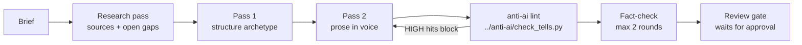
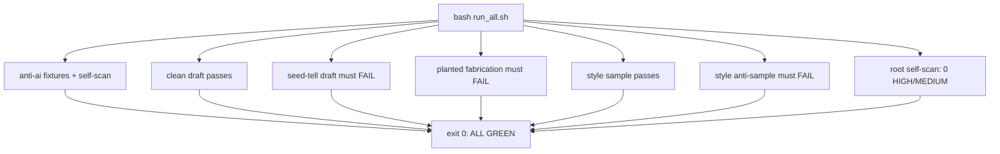

FROM THE TRENCHES · AGENT SKILLS · 2026-11-19

# A skill is a tested package, not a prompt.

At 17:37 on 2026-11-19 I made the 46th commit of the day and ran the gate one last time. ALL GREEN, 7 of 7. Earlier that same day I had asked my agent to load the blog-writer skill, and it told me that skill does not exist. I had built all three skills myself, with Mistral Large running in Vibe, so I went digging in the logs and found out why. That bug is the best way into what I shipped: three agent skills that behave less like prompts and more like small tested packages.

## The skill that did not exist.

I asked Vibe to load `blog-writer` and got back "Skill blog-writer is not available". All three skills are symlinked into `~/.vibe/skills/`, so the symlinks were fine; the manifests were not. `~/.vibe/logs/vibe.log` held 104 identical warnings:

```
Failed to parse skill at /Users/alexgris/.vibe/skills/blog-writer/SKILL.md:
1 validation error for SkillMetadata
name: String should match pattern '^[a-z0-9]+(-[a-z0-9]+)*$' [input_value='blog-writer\n']
```

The difference between the one skill that loaded and the two that did not was two lines of YAML. `blog-writer` and `alexandru-style` had written:

```yaml
name: |
  blog-writer
```

A literal block scalar keeps its trailing newline, so the parser saw `blog-writer\n`, and the name pattern stops at end of string. `anti-ai` had a plain scalar, `name: anti-ai`, which parses clean. One line per file fixed it: put the name on the same line as the key. After the edit, all three names pass a strict match, and `bash run_all.sh` still prints ALL GREEN.

The frontmatter is parsed by a machine, not read by a person. Write it like code, and check it with a tool before shipping. The spec ships one: `skills-ref validate`.

## What one skill is, per the standard.

I did not invent the format, and I did not want to. The [Agent Skills specification](https://agentskills.io/specification) says a skill is a directory with one needed file: `SKILL.md`, YAML frontmatter plus instructions, and optional `scripts/`, `references/`, `assets/` alongside it. Only the frontmatter is always in the agent's context; everything else loads on demand. That progressive disclosure is the whole trick, which is why the spec caps `SKILL.md` at 500 lines and tells you to push detail into referenced files one level deep.

Anthropic published the same shape as an open standard in December 2025 ([engineering post](https://www.anthropic.com/engineering/equipping-agents-for-the-real-world-with-agent-skills)). The point I care about from their side: bundled code runs without its content entering the model's context. Deterministic, repeatable. A skill with a script beats a wall of prose for anything mechanical.

The [Claude authoring best practices](https://platform.claude.com/docs/en/agents-and-tools/agent-skills/best-practices) add the routing rule: the `description` field is what the model uses to choose among 100 or more skills, so you write triggers into it, and you test the skill on every model you plan to run. Match the freedom you give the agent to how hazardous the task is. The [Vibe docs](https://docs.mistral.ai/vibe/code/cli/skills) show the same spec from my side of the fence: discovery from `~/.vibe/skills/`, `./.vibe/skills/`, `./.agents/skills/`; review any skill that can call write-capable tools before enabling it; keep project skills in `./.vibe/skills/` so collaborators review them in code review; pin a commit for reproducible output.

## The architecture of what I shipped.

The collection is one folder per skill: a `SKILL.md` manifest, a `references/` directory the agent reads on demand, runnable code, and a `tests/` directory holding controls. `anti-ai` ships a 548-line scanner plus `patterns.json` with 473 versioned patterns across English, Romanian, and French, and seven reference docs. `blog-writer` ships a six-pass pipeline and four reference files, gated by `tests/validate_draft.py`. `alexandru-style` ships a 120-line design spec with 18 color tokens, the full brand toolkit (canonical `tokens.css`, templates, eight scripts, samples), gated by `tests/check_styled.py`.

The wiring is the architecture. `blog-writer`'s prose pass calls `../anti-ai/check_tells.py` on every draft and blocks on HIGH hits, so one skill enforces another skill's rules:



And `run_all.sh` at the root runs all seven controls in one pass, each in its declared direction: expected-pass controls must exit 0, expected-fail controls must exit non-zero, and it self-scans the root files for tell hits:



`AGENTS.md` does the same routing for agents instead of prose: load the skill that owns the task, never edit the scanner or the pattern file, treat everything under `*/tests/` as a control, prove every change with the gate script. One concern per folder, wired together by one command.

## How the linter was calibrated.

`anti-ai` did not start from a list of phrases I dislike. It started from my own blog: 90 posts, 2008 to 2025, 55,700 words. The blog has two eras and I keep them apart. 2008-2013 was a personal journal, about 45,200 words; 2014-2025 are essays, 10,400 words. The current voice is the recent era: "I" drops from 13.4 to 8.4 per 1,000 words, "you" rises to 10.7, exclamations go from 58 down to 1, sentences average from 19.8 down to 15.0 words. There is exactly one true em-dash in 55,700 words, and the 266 occurrences of " - " are list syntax, not pauses.

Then I scored three more texts against the same blocklist. An internal memo by another author (5,100 words, 404 sentences, you-to-I about 14 to 1, zero blocklist words in the whole page) and an unedited work doc (1,500 words, typos left in) both scored REVIEW with 0 HIGH. A model draft of about 1,000 words scored FAIL with 3 HIGH. That is where the three verdicts come from, and the real lesson: density is the discriminator, not the isolated hit. The same phrase at high density with an empty second clause is a tell; at human density it is noise. Unedited human prose scores REVIEW, not PASS. FAIL means patterns, not imperfection.

The measured voice became the house rules in `references/alex-style.md`: if it is a list, make it bullet points; headings are declarative sentences; no closing moral; concrete nouns; first person used sparingly; zero em-dashes; colon as the pause before the fact. Copy the file, measure your own corpus, replace my numbers with yours.

Two rules I never break, both written in `AGENTS.md`. Never edit `check_tells.py` or `patterns.json` to make a hit go away: if a trap fires, the text is wrong, not the detector. And when a metaphor goes, expand it into the concrete mechanism instead of deleting it (rule 1b): "care widens the room people have to think and act" becomes "care means people can decide, disagree and act without you in the room". A deleted metaphor leaves a hole the reader fills with a stock phrase.

The pattern file moved from 442 to 468 to 473 phrases across the day. v0.12.0 fixed a dead conjunction guard (stray 0x08 bytes) and added the long parallel-pair heuristic. v0.12.1 added the mirrored-summary heuristic and the clean-scan sign-off. The regression fixtures are 83 CSV rows in three languages: 59 MUST-FAIL rows, all firing, and 24 MUST-PASS rows, all clean. Both directions must hold, so an edit cannot silently break one language. Romanian and French are first-class, with their own annexes and the recipe to recalibrate the word-length numbers.

## What broke, and what I did about it.

By 13:25 a wrong-path push (`cf05631`) had clobbered the root README and left eleven stray copies of the skill at the repo root; the cleanup took twelve commits at 14:09. Earlier, an accidental truncation hit two reference files and had to be reverted, the Romanian wording in them was then fixed five times in a row, and `alex-style.md` got clobbered by its own byte-restore commit and had to be fixed twice. I also humanized the skill's own docs until the scanner reported 0 HIGH and 0 MEDIUM on every markdown file, by quoting the example tell-phrases instead of using them.

The worst one was binary. A test push of a 48,223-byte PNG came back as 71,444 bytes. The connector writes text only, so UTF-8 inflation corrupts binaries on the way in. I deleted the corrupt file and put the full brand snapshot (79 files, 9.4 MB, 17 TTF fonts) into `binaries-archive/` as base64 text in 11 parts, byte-identical to the official GitHub tarball, with a SHA-256 checksum and a one-command restore.

So at 15:45 I wrote `run_all.sh`. Wrong-path pushes are a Tuesday, not an edge case.

## Where my build agrees with the best practices, and where it does not.

Mostly it agrees, because the best practices are good. Small `SKILL.md` with progressive disclosure: straight from the [spec](https://agentskills.io/specification). Description as trigger text, tested on every model: straight from [Claude's guide](https://platform.claude.com/docs/en/agents-and-tools/agent-skills/best-practices). Ship code for the deterministic parts: straight from [Anthropic's post](https://www.anthropic.com/engineering/equipping-agents-for-the-real-world-with-agent-skills). Controls in both directions, starting from a small CSV with negative cases, 10 to 20 prompts per skill: straight from [OpenAI's evals guide](https://developers.openai.com/blog/eval-skills). Project skills in `./.vibe/skills/`, review write-capable ones, pin a commit: straight from the [Vibe docs](https://docs.mistral.ai/vibe/code/cli/skills). Doc archetypes from [Diataxis](https://diataxis.fr/start-here/) instead of a default listicle: that one is baked into `blog-writer`'s Pass 1. And Anthropic's [Building effective agents](https://www.anthropic.com/research/building-effective-agents) is the reason the whole layout is one concern per folder instead of a framework.

Where I push back is the skeptic's corner. [Steve Kinney](https://stevekinney.com/writing/agent-skills) says skills are context management, routing plus progressive disclosure, not "smarter prompts"; that the proving kind of skill pays off most; and that you build the evals before the skill, with a baseline run without it. I agree with all of it. My one addition: a markdown file on its own is a saved prompt, and the skeptics are right about that part. The package is what changes the category. Ship the code and the controls in the same folder, or it is prose the agent re-reads every time.

What I would defend:

- **Code in the folder.** The scanner and the style checker run the same on every machine, so the mechanical parts do not drift with the model.
- **Controls in both directions.** A must-fail fixture that stops firing tells you the detector rotted. That is worth more than any single pattern.
- **Self-scanning docs.** The repo's own markdown sits at 0 HIGH and 0 MEDIUM under the linter it ships.
- **One gate command.** `bash run_all.sh` is the whole CI. No dashboard, no pipeline file.

What I would change next time:

- **The regex linter overreaches by design.** REVIEW exists because the human call stays mine. Next version scores density per category, not just globally.
- **Skills behave differently per model.** I test on the models I run, but the skill file cannot enforce that; it can only say so.
- **The base64 archive is a workaround, not a design.** It exists because one connector writes text only. Restore once, commit the binaries at their real paths, drop the archive.

## Where it stands now.

`bash run_all.sh` prints ALL GREEN, 7 of 7 controls in their declared direction. A fresh session loads all three skills; the frontmatter fix at the top is what un-hid two of them. The collection is MIT-licensed, runs offline with plain Python, no accounts, no telemetry. This post lives in the repo at `docs/skills-architecture.md`.

Colophon: these three skills were designed, built, and iterated with Mistral Large as the model, running in Vibe, across 46 commits on 2026-11-19. The patterns, gates, and numbers are mine; the format belongs to the open standard.

## Sources

- [Agent Skills specification](https://agentskills.io/specification)
- [Anthropic Engineering: Equipping agents for the real world with Agent Skills](https://www.anthropic.com/engineering/equipping-agents-for-the-real-world-with-agent-skills)
- [Claude Platform Docs: Skill authoring best practices](https://platform.claude.com/docs/en/agents-and-tools/agent-skills/best-practices)
- [Anthropic Research: Building effective agents](https://www.anthropic.com/research/building-effective-agents)
- [OpenAI Developers: Testing agent skills systematically with evals](https://developers.openai.com/blog/eval-skills)
- [Diataxis: Start here](https://diataxis.fr/start-here/)
- [Mistral Vibe docs: Skills](https://docs.mistral.ai/vibe/code/cli/skills)
- [Steve Kinney: Agent skills, stripped of hype](https://stevekinney.com/writing/agent-skills)
