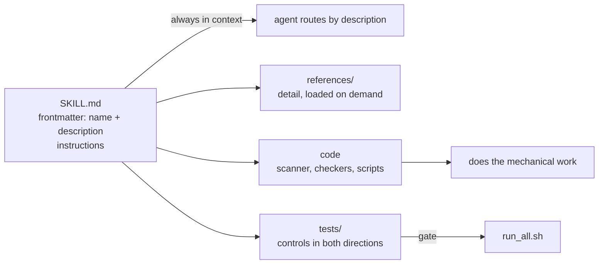
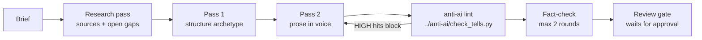
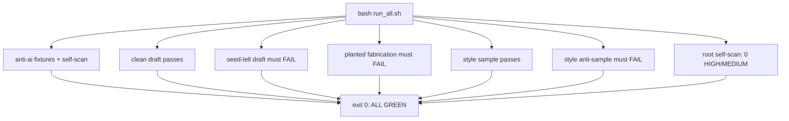

FROM THE TRENCHES · AGENT SKILLS · 2026-11-19

# Skills that ship tests beat skills that ship prose.

At 17:37 on 2026-11-19 I made the 46th commit of the day and ran the gate one last time: ALL GREEN, 7 of 7. Earlier that day my agent had told me the blog-writer skill does not exist. I had built all three skills myself, with Mistral Large running in Vibe. The cause turned out to be two lines of YAML, and it is a good door into the rest of this post: the why, then the machinery, then the mapping against what the field says to do.

## I wanted to share what I read, not what a model invents.

For years I have kept a reading list: every entry has a headline, a priority line, and a paragraph on why it mattered. When I want to share those recommendations, I do not want to paste a model's summary of them. I hated what AI writing looked like by then: the same metaphors, the same inflated verbs, the same closing moral. Every draft read like someone else's notes on a book neither of us had read.

The last two months showed me the other side of the same coin. I have been listening almost exclusively to podcasts I made for myself, because I wanted content customized to what I am working on this week, not a generic episode. That felt like the future: high-quality content, extremely customized, produced on demand. I believe that future is real and it is a bright one. But customization only works if the agent writes in your voice and follows your rules. Taste has to be packaged, not re-explained in every chat. That is the problem these three skills solve.

So each skill does one job. `anti-ai` keeps prose human: my measured voice as 473 regex patterns plus house rules, run as code, not as a prompt. `blog-writer` is the pipeline that produced this post: research with real links, structure, voice, lint, fact-check, and a gate that waits for my approval. `alexandru-style` is my site's design system as 18 tokens and templates, so anything rendered looks like alexandrugris.ro instead of a default theme.

## Each skill is one folder: a manifest, references, code, and controls.

The layout repeats three times. A `SKILL.md` manifest carries the frontmatter (a `name`, and a `description` written as a trigger: "use when ...") plus the instructions. A `references/` directory holds the detail, which the agent reads on demand. Code does the mechanical work. A `tests/` directory holds controls in both directions: cases that must pass and cases that must fail.

`anti-ai` is `check_tells.py` (548 lines) loading `patterns.json` (473 versioned patterns; 58 high, 245 medium, 170 low severity; English, Romanian, French) and printing every hit with line, severity, and a fix. Verdicts: FAIL on any HIGH, REVIEW on MEDIUM only, PASS otherwise. Quotes and literal contexts are exempt, and the exemption is reported, not dropped. The house rules measure rhythm: sentence-length bands, an em-dash budget, word length. The hard rules live in `AGENTS.md`: fix the text, never the detector; when a metaphor goes, expand it into the concrete mechanism (rule 1b); the fixtures keep their declared direction. Today that means 59 MUST-FAIL rows all firing and 24 MUST-PASS rows all clean, across 83 CSV rows in three languages. The scanner also self-scans the skill's own docs: 0 HIGH, 0 MEDIUM.

`blog-writer` runs six passes in order: brief; research, where every external claim gets a URL opened in the session and open gaps stay flagged; a structural pass that picks a Diataxis archetype instead of defaulting to a listicle; a prose pass that writes in voice, then runs `../anti-ai/check_tells.py` on the draft and blocks on HIGH hits; a fact-check loop of at most 2 rounds, where blocking findings are contradictions, dead links, and fabrications, and the fix for an unverifiable claim is to delete or recast it, never to invent a replacement source; and a review gate that presents sources, findings, and gaps, and waits for approval. The machine gate is `tests/validate_draft.py`; its controls are a clean draft that passes, plus a tell-laced seed and a planted-fabrication draft that must fail.

`alexandru-style` is `design-system.md`, 120 lines and 18 color tokens distilled from the CSS of alexandrugris.ro: paper `#FBFAF7` never pure white, ink `#30332F`, one burgundy accent `#8D2829` per visual block, Georgia for voice, Inter in uppercase for labels, IBM Plex Mono for code, 1px hairlines, ragged-right text. `brand/` holds the full toolkit: the canonical `tokens.css`, the written spec, two templates, eight render scripts, the sample gallery, the font licenses, and the base64 binaries archive. The bar is `tests/check_styled.py`: the sample page passes; the anti-sample (white ground, gradient headline, text shadow, dashed rules, centred copy, emoji) must fail.

The wiring between them:

`AGENTS.md` does the routing for coding agents: load the skill that owns the task, never edit the scanner or the pattern file, treat everything under `*/tests/` as a control, prove every change with `run_all.sh`, which runs all seven controls in their declared directions and self-scans the root files. One gotcha worth knowing: frontmatter is checked by a machine, not read by a person. I had written `name:` with a literal block, which keeps its trailing newline, and Vibe's name pattern rejected it: 104 warnings in the log, two skills silently skipped. A plain scalar fixed it. Frontmatter gets checked by a tool, not by eye.

## What Anthropic, OpenAI, and the spec say to do.

- The [Agent Skills spec](https://agentskills.io/specification): a directory with a required `SKILL.md` (frontmatter plus instructions) and optional `scripts/`, `references/`, `assets/`; frontmatter always in context, the rest on demand (progressive disclosure); keep `SKILL.md` under 500 lines; relative paths one level deep; check with `skills-ref validate`; `name` must match `^[a-z0-9]+(-[a-z0-9]+)*$`.
- [Anthropic's engineering post](https://www.anthropic.com/engineering/equipping-agents-for-the-real-world-with-agent-skills): the format became an open standard in December 2025; skills are folders of instructions, scripts, and resources; bundled code executes without entering the model's context, so it stays deterministic and repeatable.
- [Anthropic, Building effective agents](https://www.anthropic.com/research/building-effective-agents): the systems that worked used simple composable patterns, not frameworks; routing exists for separation of concerns; start with plain workflows, add agents only where the task needs them.
- [Claude skill-authoring best practices](https://platform.claude.com/docs/en/agents-and-tools/agent-skills/best-practices): the `description` field is what picks the right skill among 100 or more, so write specific triggers; test the skill on every model you plan to run; match the degree of freedom you give the agent to how hazardous the task is.
- [OpenAI's guide to evals for skills](https://developers.openai.com/blog/eval-skills): an eval is prompt, captured run, checks, score; 10 to 20 prompts per skill catch regressions; start from a small CSV and grow it; include negative controls (`should_trigger=false`); deterministic graders first.
- [Mistral Vibe docs](https://docs.mistral.ai/vibe/code/cli/skills): Vibe follows the same spec, so skills are portable; discovery from `~/.vibe/skills/`, `./.vibe/skills/`, `./.agents/skills/`; review any skill that can call write-capable tools before enabling it; keep project skills in `./.vibe/skills/` for code review; pin a commit for reproducible output.
- [Diataxis](https://diataxis.fr/start-here/): pick the documentation archetype on purpose (tutorial, how-to, reference, explanation); the compass is action versus cognition and study versus work.
- [Steve Kinney's skeptical take](https://stevekinney.com/writing/agent-skills): skills are context management, not "smarter prompts"; verification skills pay off most; build the evals before the skill, with a baseline run without it.

## My three skills against that advice.

| Best practice (source) | anti-ai | blog-writer | alexandru-style |
|---|---|---|---|
| Small `SKILL.md`, progressive disclosure ([spec](https://agentskills.io/specification)) | manifest plus 7 reference docs loaded on demand | manifest plus 4 pass files | 120-line spec plus `brand/` references |
| `description` as trigger text ([Claude](https://platform.claude.com/docs/en/agents-and-tools/agent-skills/best-practices)) | "use when prose must read as human" | "load when asked to write or revise an article" | "load for any styled deliverable" |
| Deterministic code for the mechanical work ([Anthropic](https://www.anthropic.com/engineering/equipping-agents-for-the-real-world-with-agent-skills)) | `check_tells.py` over `patterns.json` | `validate_draft.py` calls the scanner | `check_styled.py` plus 8 render scripts |
| Controls in both directions, CSV, negative cases ([OpenAI](https://developers.openai.com/blog/eval-skills)) | 83 fixture rows: 59 MUST-FAIL, 24 MUST-PASS | clean draft passes; seed and planted-fabrication fail | sample passes; anti-sample fails |
| Test on every model you run ([Claude](https://platform.claude.com/docs/en/agents-and-tools/agent-skills/best-practices)) | patterns are model-agnostic regex | pipeline is model-agnostic; voice lives in references | tokens are model-agnostic |
| Freedom matched to hazard ([Claude](https://platform.claude.com/docs/en/agents-and-tools/agent-skills/best-practices)) | scanner advises; it never edits text | review gate waits for approval; escalation routes to Pass 1 | checker advises; a human renders |
| One concern per folder ([Building effective agents](https://www.anthropic.com/research/building-effective-agents)) | linter only | pipeline only | style only |
| Doc archetypes ([Diataxis](https://diataxis.fr/start-here/)) | references are reference-type docs | Pass 1 picks the article archetype | per-medium recipes in the manifest |
| Reviewable in code review, pin a commit ([Vibe](https://docs.mistral.ai/vibe/code/cli/skills)) | one repo, one gate script | same repo, same gate | same repo, same gate |
| Frontmatter checked by a tool ([spec](https://agentskills.io/specification)) | the literal-block `name` newline bug; plain scalar fixed it | same fix | same fix |

What the mapping buys: the mechanical parts run the same on every machine and every model, and a control that stops firing tells me the detector rotted. What it costs: maintenance. Every pattern bump is a version bump with fixtures to keep green, and the regex linter overreaches by design, so REVIEW stays a human call.

## Calibrating the linter by arguing with my own agent.

The calibration was trial and error with traces, not a one-shot list. I ran the scanner on model drafts, read every hit in the trace, and fed the agent feedback until the rules matched what I object to. When a rule was wrong, I fixed the rule and versioned it: v0.12.0 repaired a dead conjunction guard (stray 0x08 bytes) and added the parallel-pair heuristic; v0.12.1 added the mirrored-summary heuristic and the clean-scan sign-off. When the text was wrong, I fixed the text. That split is the whole method.

The measuring stick was human text, not more AI output. My blog gave the house rules: two eras, and the current one runs about 15 words per sentence, addresses the reader directly, and contains one em-dash in 55,700 words. Against the same blocklist, an internal memo and an unedited work doc scored 0 HIGH, while a model draft scored 3 HIGH in about a thousand words. Density, not the single hit, is the tell. That is why there are three verdicts: FAIL, REVIEW, PASS, and why REVIEW is where good human writing lives.

Multilingual came from the same method: Romanian and French got their own annexes and their own fixture rows, with a recipe to recalibrate the word-length numbers, which are English-calibrated. Today no language can silently rot, because the fixtures enforce it.

## The day broke things. I was the one steering.

I pushed to the wrong path at 13:25 and clobbered the root README; the gate flagged it and I cleaned up twelve commits' worth of stray copies by 14:09. A binary test came back corrupted (a 48,223-byte PNG returned as 71,444 bytes), so I measured the bytes, concluded the connector writes text only, and archived the brand snapshot as base64 in 11 parts with a SHA-256 restore. When our own docs tripped the scanner, I humanized the docs by quoting the example phrases, not by editing the detector. Every time, the human at the keyboard decided, and the gate made sure the fix stuck: `run_all.sh` went in at 15:45 and has printed ALL GREEN since.

## What good editing means, in rules you can run.

From the sources, the principles behind these skills:

- **Edit what you can measure.** Voice becomes numbers (sentence length, em-dash count, word length), then a scanner checks them. Vibes in a prompt drift; a regex does not. Deterministic graders first, rubric grading after. ([OpenAI evals guide](https://developers.openai.com/blog/eval-skills))
- **Check the mechanical parts with tools, not eyes.** The spec ships `skills-ref validate` for exactly the newline bug I hit. ([spec](https://agentskills.io/specification))
- **Give the agent only what it needs now.** The manifest routes, the references load on demand. ([spec](https://agentskills.io/specification))
- **Define good before you polish.** Evals and controls first, with a baseline run and negative cases. ([OpenAI](https://developers.openai.com/blog/eval-skills), [Kinney](https://stevekinney.com/writing/agent-skills))
- **Route feedback to the pass that owns it.** Structure goes back to the structural pass, wording to the copy pass, facts to research. ([Building effective agents](https://www.anthropic.com/research/building-effective-agents))
- **Every external claim carries a link that was opened.** If a claim cannot be verified, delete it or recast it; never invent a source.
- **Separate the mechanical from the judgment.** Code decides what it can (FAIL), the human keeps the REVIEW call, and PASS is the floor, not the goal.

## Where it stands now.

`bash run_all.sh` prints ALL GREEN, 7 of 7 controls in their declared direction. A fresh session loads all three skills after the frontmatter fix. The collection is MIT-licensed, runs offline with plain Python, no accounts, no telemetry. This post lives in the repo at `docs/skills-architecture.md`.

Colophon: these three skills were designed, built, and iterated with Mistral Large as the model, running in Vibe, across 46 commits on 2026-11-19. The patterns, gates, and numbers are mine; the format belongs to the open standard.

## Sources

- [Agent Skills specification](https://agentskills.io/specification)
- [Anthropic Engineering: Equipping agents for the real world with Agent Skills](https://www.anthropic.com/engineering/equipping-agents-for-the-real-world-with-agent-skills)
- [Claude Platform Docs: Skill authoring best practices](https://platform.claude.com/docs/en/agents-and-tools/agent-skills/best-practices)
- [Anthropic Research: Building effective agents](https://www.anthropic.com/research/building-effective-agents)
- [OpenAI Developers: Testing agent skills systematically with evals](https://developers.openai.com/blog/eval-skills)
- [Diataxis: Start here](https://diataxis.fr/start-here/)
- [Mistral Vibe docs: Skills](https://docs.mistral.ai/vibe/code/cli/skills)
- [Steve Kinney: Agent skills, stripped of hype](https://stevekinney.com/writing/agent-skills)
